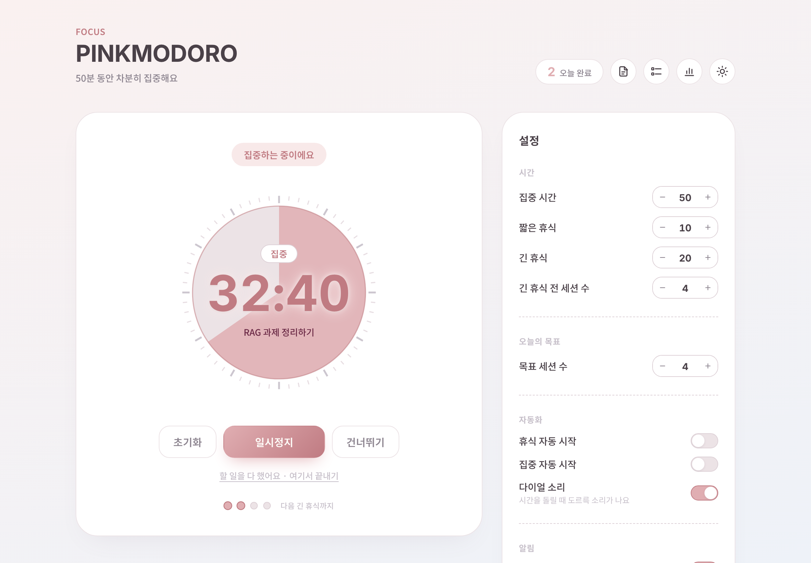
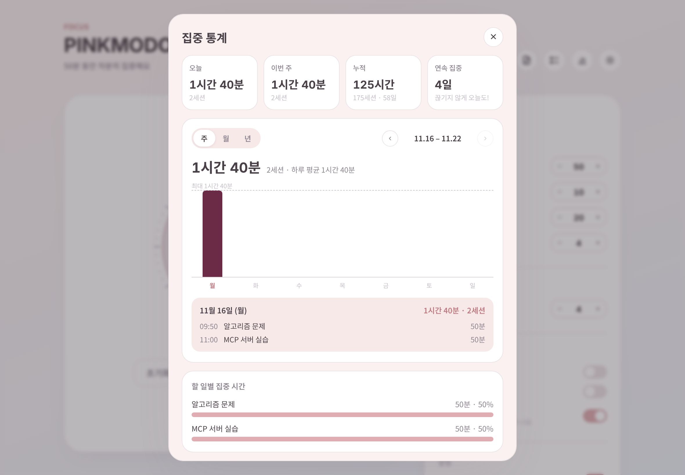
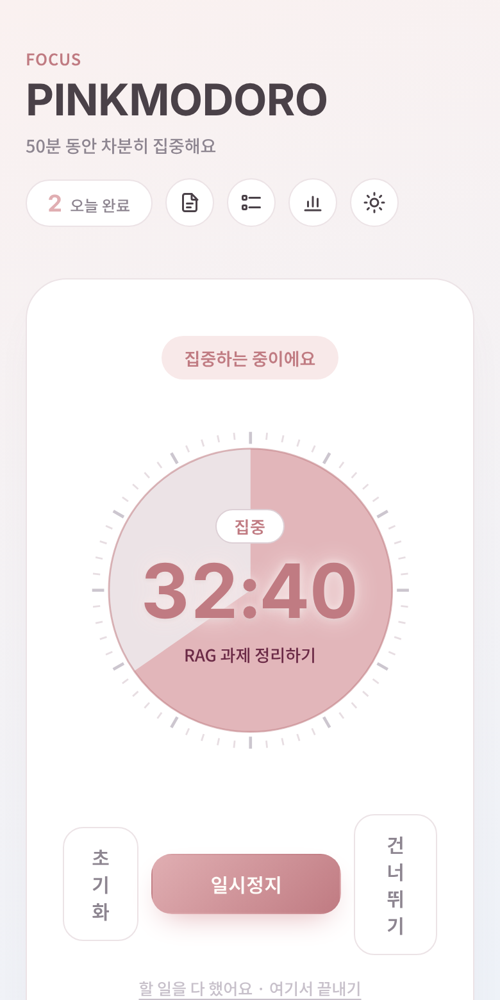

# PINKMODORO

**남은 시간이 줄어드는 게 눈에 보이는 뽀모도로 타이머.**
숫자를 읽지 않아도, 분홍색 파이가 줄어드는 모양만 보고 시간이 얼마나 남았는지 알 수 있어요.

### 👉 [바로 써보기: gawonm.github.io/pinkmodoro](https://gawonm.github.io/pinkmodoro/)

가입이나 설치 없이 브라우저에서 바로 쓸 수 있어요. 기록은 서버로 보내지 않고 내 기기(브라우저)에만 저장돼요.



<table>
  <tr>
    <td width="62%"></td>
    <td width="38%"></td>
  </tr>
  <tr>
    <td align="center">집중 통계</td>
    <td align="center">휴대폰에서도</td>
  </tr>
</table>

## 이런 분께 맞아요

- 시작하는 것 자체가 어려운 분: **"5분만 가볍게 시작하기"** 버튼으로 부담 없이 시작해요
- 집중하다가 딴생각이 자꾸 떠오르는 분: **떠오른 생각 메모**에 잠깐 적어두고 다시 집중해요
- 할 일을 일찍 끝냈는데 타이머 때문에 기다리기 싫은 분: **"할 일을 다 했어요"** 로 그 자리에서 끝내도 기록돼요
- 내가 언제 무엇에 얼마나 집중했는지 궁금한 분: **집중 통계**로 주·월·년 단위 기록을 돌아봐요

## 기능

- 드래그로 세션 길이를 조절하는 다이얼 타이머 (집중 / 짧은 휴식 / 긴 휴식)
- 오늘의 체크리스트, 빠른 메모(하루 지나면 자동 삭제)
- 세션 기록 로그 + 세션별 진행 메모("어디까지 했는지")
- 집중 통계: 오늘/이번 주/누적/연속 집중일, 주·월·년 단위 막대 차트(지난 기간 대비), 할 일별 집중 시간, 시간대별 집중 분포
- 오늘의 목표 세션 수 설정, 세션 완료마다 격려 토스트
- 할 일을 먼저 끝냈을 때 "할 일을 다 했어요"로 조기 종료
- PWA라서 브라우저에서 바로 설치해서 쓸 수 있음
- macOS 메뉴바 / Windows 트레이에 상주하는 네이티브 위젯 (아래 참고)

## 데스크톱 위젯

웹앱을 그대로 네이티브 창 안에 띄우고, 알림과 트레이/메뉴바 아이콘만 OS 기능으로 연결한 얇은 래퍼입니다. 기능은 웹 버전과 완전히 동일합니다.

### macOS — 메뉴바 위젯

메뉴바(시계 옆)에 아이콘으로 상주하다가, 클릭하면 핑크모도로 화면이 드롭다운으로 열립니다. 세션이 끝나면 macOS 알림 센터로 바로 알려줍니다.

- **Xcode 앱 없이도** 터미널 + Command Line Tools만으로 빌드/실행할 수 있습니다 (Swift Package Manager 사용)
- 자세한 단계별 가이드: [`macos-widget/README.md`](macos-widget/README.md)

빠른 순서 (Xcode 없이):
1. `xcode-select --install`로 Command Line Tools만 설치 (Xcode 앱 전체 설치 불필요)
2. `cd macos-widget && swift run` — 바로 뜨는지 확인
3. 평소에 쓸 거면 `./build-app.sh`로 `.app`까지 묶기 (알림이 안정적으로 뜸)

Xcode GUI로 하고 싶다면 `macos-widget/README.md`의 "B. Xcode로 실행하기" 참고.

### Windows — 트레이 위젯

작업표시줄 트레이(시계 옆)에 상주하다가, 아이콘을 클릭하면 핑크모도로 화면이 창으로 열립니다. 창을 닫아도 종료되지 않고 트레이로 숨겨지며, 트레이 아이콘은 진행률 파이 모양으로 실시간 동기화됩니다.

- .NET 8 SDK + VS Code(또는 Visual Studio)로 빌드합니다 (빌드 결과물은 저장소에 포함하지 않음)
- 자세한 단계별 가이드: [`windows-widget/README.md`](windows-widget/README.md)

빠른 순서:
1. [.NET 8 SDK](https://dotnet.microsoft.com/download) 설치
2. `windows-widget` 폴더에서 `dotnet restore`
3. `dotnet run` (또는 VS Code에서 F5)
4. 더블클릭만으로 실행되는 배포용 exe가 필요하면: `dotnet publish -c Release -r win-x64 --self-contained true` (`-p:PublishSingleFile=true`는 WebView2와 호환 문제가 있어 넣지 않습니다)

## 구조

```
index.html / pomodoro-timer.html   웹앱 본체 (둘은 항상 동일하게 유지)
manifest.json, sw.js               PWA 매니페스트 / 서비스 워커
assets/                            링크 미리보기 이미지(og-image.png), README 스크린샷
macos-widget/                      macOS 메뉴바 위젯 소스 (Swift)
windows-widget/                    Windows 트레이 위젯 소스 (C# / WPF)
```
